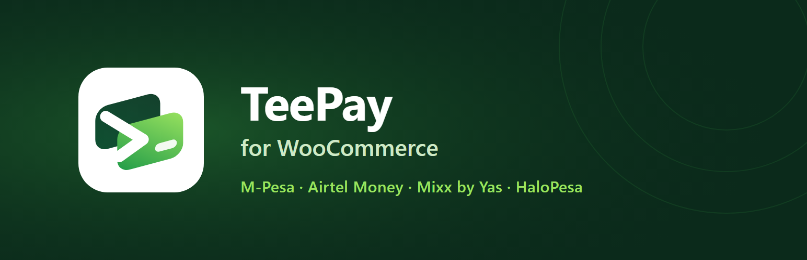

# TeePay for WooCommerce



Accept **M-Pesa, Airtel Money, Mixx by Yas and HaloPesa** in Tanzania (TZS) on WooCommerce with [TeePay](https://teepay.me).

- **Hosted checkout (recommended):** the customer pays on a TeePay page and comes back to your store.
- **Mobile money prompt:** the customer enters their Tanzanian number at checkout and approves the prompt on their phone.

Works with the classic checkout and the Cart and Checkout blocks, and supports High-Performance Order Storage (HPOS). No Composer packages or build step are needed to install it.

Full documentation: <https://docs.teepay.me/docs/plugins/woocommerce>

## Screenshots

| Settings | Checkout | Order received |
|---|---|---|
| _screenshot-1.png (placeholder)_ | _screenshot-2.png (placeholder)_ | _screenshot-4.png (placeholder)_ |

Screenshots for WordPress.org go in `.wordpress-org/` as `screenshot-1.png` and so on, matching the captions in `readme.txt`.

## Requirements

- WordPress 6.2+, WooCommerce 7.6+, PHP 7.4+
- A TeePay account with a secret key (`tp_live_...`) that has the `collection:create` and `collection:read` scopes
- Store currency TZS (or another currency listed in your key's `supported_currencies`)

## Install

1. Download the latest release zip (or `git archive` this repository; development files are excluded by `.gitattributes`).
2. In WordPress, go to **Plugins > Add New > Upload Plugin**, upload the zip and activate it.
3. Open **WooCommerce > Settings > Payments > TeePay**.

## Configure

| Setting | What to enter |
|---|---|
| Payment flow | Hosted checkout (recommended) or Mobile money prompt (requires mobile money push on your account). |
| Live secret key | `tp_live_...` from **Developers** in the TeePay dashboard. |
| Live webhook signing secret | `whsec_...` from **Developers > Webhooks**. |
| Sandbox key and secret | Optional, for checking your setup with `tp_test_` keys. |
| Payment profile ID | Optional. The TeePay payment profile this store uses. Empty uses your default profile. |
| Debug log | Writes to **WooCommerce > Status > Logs** (source `teepay`) with secrets removed. |

Then, in the TeePay dashboard, open **Payment profiles** and set the profile's:

- **Webhook URL:** `https://your-store.example/wc-api/teepay_webhook/`
- **Return URL:** `https://your-store.example/wc-api/teepay_return/`

The exact addresses for your store are shown on the settings screen. TeePay only takes return and webhook URLs from the payment profile (never per request), so a leaked key cannot redirect your customers or webhooks.

Saving the settings checks the active key with `GET /v1/capabilities` and reports what it can do.

## How payment confirmation works

An order is marked paid **only** when all of these are true:

1. The plugin read the payment from the TeePay API with your secret key:
   - hosted checkout: `GET /v1/checkout-sessions/{id}` for a session recorded on the order;
   - mobile money prompt: `GET /v1/collections/{reference}` for the reference recorded on the order.
2. TeePay reports it final: session `status` is `paid` with a `payment.reference`, or collection `status` is `succeeded`.
3. The session's `id`, `reference` (`wc-<store tag>-<order id>`) and `environment` match the order.
4. TeePay's `amount_minor` and `currency` equal the order total (converted to minor units with exact string arithmetic) and currency.

That read is triggered by:

- a **webhook**, after its `X-TeePay-Signature` (`v1=` + HMAC-SHA256 of `<timestamp>.<raw body>`) is verified against the environment's secret within a five minute window; each `X-TeePay-Event-ID` is processed once per order;
- the customer's **return** to `/wc-api/teepay_return/` (the order comes from the shopper's own WooCommerce session; query strings are ignored);
- the **order received page**, which polls the store while it waits;
- a **reconciliation job** every 15 minutes for unpaid orders from the last two days.

If TeePay reports a paid payment whose amount or currency differs from the order, the order is put **on hold** with a note and never completed automatically. Orders are locked while being confirmed so a webhook and a return visit cannot complete an order twice. Each checkout attempt uses an idempotency key derived from the order, amount, currency and attempt number, so retries never create a second session or prompt.

## Account restrictions

If TeePay answers `403 account_restricted`, shop managers (`manage_woocommerce`) see an admin notice explaining that new payments cannot be started, with the request ID and a **Check again** button. Customers only see "Mobile money payment is unavailable right now", and the method is hidden from checkout for ten minutes before it is tried again.

## Refunds

The public TeePay API does not offer refunds (`features.refunds` is always `false`), so this plugin does not support refunds from WooCommerce. Arrange the refund with TeePay and record it in WooCommerce as a manual refund.

## Sandbox and going live

Sandbox keys (`tp_test_`) verify authentication and capabilities only; TeePay moves money in live mode only. Before launch, switch sandbox mode off, take one real payment with a small amount, and check that the order is marked paid and the webhook shows as delivered in **Developers > Webhooks**.

## Development

```bash
composer install          # dev tools only: PHPUnit, WordPress Coding Standards
composer test             # unit tests (WordPress and WooCommerce are stubbed)
composer lint             # PHPCS with the WordPress standard and PHP 7.4+ compatibility
php bin/make-pot.php      # regenerate languages/teepay-for-woocommerce.pot
```

The blocks script (`assets/js/blocks/teepay-blocks.js`) is plain JavaScript using the globals WooCommerce provides, so there is no build step.

### Layout

```
teepay-for-woocommerce.php      plugin header, HPOS/blocks compatibility, bootstrap
uninstall.php                   removes settings, cached data and the scheduled job
includes/
  class-teepay-wc-api-client.php      dependency-free client for https://api.teepay.me
  class-teepay-wc-webhook-verifier.php
  class-teepay-wc-payment-evaluator.php  rules for "paid"
  class-teepay-wc-order-service.php      start payments, confirm orders
  class-teepay-wc-webhook-handler.php
  class-teepay-wc-gateway.php            WC_Payment_Gateway
  class-teepay-wc-blocks-support.php     Checkout block integration
  class-teepay-wc-plugin.php             endpoints, cron, notices
assets/                         icon and scripts
languages/                      .pot file
tests/                          PHPUnit tests and stubs
.wordpress-org/                 WordPress.org banner and icon
```

## Security

Report vulnerabilities privately to TeePay support rather than opening a public issue.

## License

GPL-2.0-or-later. See [LICENSE](LICENSE).
